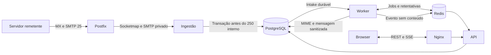

# Correio Temporário · 00duHot

Serviço independente para receber e ler mensagens descartáveis. O visitante recebe um endereço sem cadastro. A administração tem sessão própria e consulta somente indicadores, domínio, status de caixas e auditoria técnica.

O 00duHot existente é um aplicativo React, Vite, TanStack Start e Supabase/Lovable, com serviços e aplicativos Windows separados. Este módulo fica em `apps/temp-mail`, com seu próprio pnpm e lockfile. O catálogo aponta para `/email-temporario`, que abre a origem do serviço quando `VITE_TEMP_MAIL_URL` estiver configurada no build do 00duHot. PostgreSQL, sessão e ingestão do correio são independentes do Supabase e do deploy Lovable.

## Estrutura

| Caminho | Responsabilidade |
| --- | --- |
| `web/` | React, TypeScript, Vite, Lucide e CSS responsivo |
| `src/api.mjs` | API Fastify, REST, OpenAPI, cookies privados, administração e SSE |
| `src/ingest.mjs` | Serviço SMTP interno e socketmap de domínio/destinatário do Postfix |
| `src/worker.mjs` | Redis/BullMQ, entrega idempotente e expiração automática |
| `src/mime.mjs` | Mailparser e sanitização por lista de permissões |
| `prisma/` | Schema PostgreSQL e migration versionada |
| `infrastructure/` | Postfix, Nginx e configuração TLS |
| `tests/` | Casos unitários, SMTP, segurança e Playwright |
| `compose*.yaml` | Serviços, portas locais e configuração pública separada |

O frontend reutiliza a combinação React/Vite do projeto principal. A API usa Fastify e módulos Node para manter REST, OpenAPI e SMTP em processos separados com poucas dependências.



O Postfix responde ao remetente externo depois de gravar sua fila local, mantida em volume. A ingestão responde 250 ao Postfix depois do commit PostgreSQL. Uma varredura recorrente recria jobs pendentes a partir do banco depois de falhas no Redis. As retentativas usam backoff e erros finais podem ser reenfileirados pelo painel enquanto a caixa existir. O corpo MIME bruto é apagado após processamento. A deduplicação por destinatário e Message-ID inclui o remetente do envelope e continua efetiva após a exclusão de uma mensagem.

O SMTP público só recebe. O Postfix recusa domínios externos e destinatários desconhecidos em RCPT. O domínio virtual aponta para o diretório dinâmico de caixas ativas, sem wildcard que aceite endereços arbitrários. O worker limita a exposição de HTML, remove scripts, links ativos, estilos de terceiros e imagens. Anexos são descartados. A interface também isola o HTML em iframe com sandbox e CSP. O painel não tem leitura de mensagens.

## Iniciar em um ambiente limpo

Pré-requisitos: Node.js 24 LTS e Docker Engine com Compose v2. No Windows, use Docker Desktop com o motor Linux funcionando. Clone o repositório e execute na raiz:

```sh
cd apps/temp-mail
node scripts/init-env.mjs
docker compose up --build --wait
```

Abra **http://localhost:8080**. As portas de desenvolvimento são restritas ao loopback. Postfix recebe em **127.0.0.1:1025**. Mailpit fica em **http://localhost:8025**, com SMTP local em **127.0.0.1:1026**. O domínio reservado `mail.test` só existe neste ambiente. Copie o endereço gerado na interface e execute:

```sh
node scripts/send-test-mail.mjs 'COLE_AQUI_O_ENDERECO_GERADO'
node scripts/send-test-mail.mjs 'COLE_AQUI_O_ENDERECO_GERADO' --mailpit
```

O segundo comando passa pelo Mailpit, que retém uma cópia local e encaminha apenas o padrão de endereços de teste para o Postfix. A API documentada em OpenAPI está em **http://localhost:8080/api/openapi.json**. Requisições mutáveis exigem o cabeçalho `X-Mail-Action: 1` e a origem do serviço. O cookie de sessão é enviado pelo navegador, nunca em parâmetros de URL.

A migração e o seed rodam automaticamente antes de iniciar os processos. Para repetir conscientemente em um ambiente existente:

```sh
docker compose run --rm migrate
```

### Criar um administrador

Em Bash, informe um e-mail controlado por você e uma senha exclusiva de pelo menos 16 caracteres. O comando passa a senha via ambiente de um container descartável, sem imprimi-la nem salvá-la no arquivo de configuração:

```sh
read -r -p 'E-mail administrativo: ' ADMIN_EMAIL
read -rs -p 'Senha administrativa: ' ADMIN_PASSWORD
printf '\n'
export ADMIN_EMAIL ADMIN_PASSWORD
docker compose run --rm -e ADMIN_EMAIL -e ADMIN_PASSWORD migrate
unset ADMIN_EMAIL ADMIN_PASSWORD
```

Abra **http://localhost:8080/admin**. O seed não substitui uma senha já cadastrada. O login exige a conta criada pelo operador e aplica limite de tentativas. Desative um domínio para impedir novos recebimentos imediatamente. As caixas existentes continuam legíveis até a expiração ou a exclusão explícita.

### Desenvolvimento com processos separados

Instale `pnpm@11.25.0` usando npm ou Corepack. Em um banco dedicado já disponível, defina `DATABASE_URL`, `REDIS_URL`, `APP_URL=http://localhost:5173`, `MAILBOX_TOKEN_SECRET` (64 caracteres hexadecimais) e `DEFAULT_MAIL_DOMAIN=mail.test`.

```sh
pnpm install --frozen-lockfile
pnpm exec prisma generate
pnpm db:migrate
pnpm db:seed
```

Em terminais separados, com o mesmo ambiente, execute `pnpm start:api`, `pnpm start:worker`, `pnpm start:smtp` e `pnpm dev:web`. O frontend Vite encaminha `/api` para a porta 3001. Para validar o código execute `pnpm run build`, `pnpm exec tsc --noEmit` e `pnpm test`.

### Integração e navegador

Use um ambiente descartável separado dos dados operacionais. O Compose de testes executa as verificações em um container na rede privada. A integração manipula a expiração diretamente no banco de teste. Prepare um administrador de teste pelo seed, exporte os mesmos valores em `TEST_ADMIN_EMAIL` e `TEST_ADMIN_PASSWORD`, e execute:

```sh
export COMPOSE_FILE=compose.yaml:compose.override.yaml:compose.test.yaml
node scripts/init-env.mjs
docker compose up --build --wait
docker compose run --rm --no-deps verify
pnpm exec playwright install chromium
pnpm run test:e2e
```

Os testes enviam mensagens pelo SMTP do Postfix, verificam PostgreSQL, sanitização, eventos SSE, separação de caixas, expiração, operações administrativas, limites e o fluxo no Chromium. A ação do GitHub usa Linux, conta de teste e volumes descartáveis. O encerramento comum `docker compose down` preserva os volumes. Use `docker compose down --volumes` somente no ambiente descartável em que a remoção dos dados é esperada.

## Produção em VPS Linux

1. Use VPS com IPv4 estável, Docker/Compose, disco persistente e permissão de **entrada TCP 25**. Confirme com o provedor antes de divulgar os endereços. Abra TCP 80/443 para a web. PostgreSQL, Redis, ingestão e socketmap ficam nas redes privadas do Compose.
2. Reserve um hostname web e um hostname SMTP. Adquira certificados separados, por exemplo com um cliente ACME usando desafio DNS-01. Disponibilize `fullchain.pem` e `privkey.pem` em diretórios separados, com leitura restrita ao processo correto. Configure uma rotina de renovação que recarregue os serviços. Nunca versionar chaves.
3. A partir de um `.env` novo, configure `APP_URL=https://<host-web>`, `WEB_HOST`, `SMTP_HOST`, `DEFAULT_MAIL_DOMAIN`, `ABUSE_CONTACT`, `TLS_WEB_DIR` e `TLS_SMTP_DIR`. Preserve os segredos aleatórios do gerador. Se definir a senha do PostgreSQL manualmente, use hex aleatório para que funcione na URL do banco.
4. Execute os comandos abaixo a partir do módulo. Passe as credenciais iniciais pelo seed descartável com as mesmas flags `-f`. Registre os domínios adicionais como desativados, verifique o DNS e só depois ative-os.
5. De um servidor externo, envie um e-mail para uma caixa criada na origem pública. Confirme aceitação pelo MX e entrega na interface, sem atualizar a página. Somente após essa validação configure `VITE_TEMP_MAIL_URL` no 00duHot e publique o frontend existente pelo Lovable.

```sh
docker compose -f compose.yaml -f compose.prod.yaml config --quiet
docker compose -f compose.yaml -f compose.prod.yaml up --build --wait
docker compose -f compose.yaml -f compose.prod.yaml ps
```

### DNS

Substitua os exemplos pelo domínio e IP que controla.

| Nome | Tipo | Valor/condição |
| --- | --- | --- |
| `mx.exemplo.com` | A | IPv4 público do Postfix |
| `correio.exemplo.com` | A | IPv4 público do Nginx |
| `temporario.exemplo.com` | MX | `10 mx.exemplo.com.` |
| Hostnames com IPv6 | AAAA | Publique somente após habilitar e testar IPv6 no host, Docker e Postfix. A configuração fornecida do Postfix usa IPv4. |
| Domínio que só recebe | TXT/SPF | `v=spf1 -all`, somente se nenhum outro serviço enviar por esse domínio |
| `_dmarc.<domínio>` | TXT/DMARC | Defina política coerente com o domínio. Use `v=DMARC1; p=reject` apenas quando ele for exclusivo de recebimento e não houver remetentes legítimos. |
| IP público | PTR | Solicite ao provedor do IP, se disponível. Use um hostname com DNS direto consistente. |

SPF, DMARC e PTR não substituem o MX. Use DNS sem proxy HTTP para o hostname do MX. O HTTPS protege a sessão web. SMTP usa STARTTLS oportunista para interoperar com remetentes sem TLS. A comunicação entre Postfix e a ingestão acontece exclusivamente na rede interna.

### Operação, privacidade e recuperação

- Monitore `/api/health/ready`, heartbeats no painel, mensagens pendentes ou com falha, disco dos três volumes e a fila `postqueue -p`. Faça um probe SMTP externo periódico com uma caixa de teste.
- Escale o worker com `docker compose -f compose.yaml -f compose.prod.yaml up -d --scale worker=2`. Os jobs são compartilhados e as transações serializam ações concorrentes na mesma caixa.
- Faça backups criptografados e com retenção curta, em armazenamento restrito. Para configurações administrativas, use `pg_dump` somente das tabelas necessárias, excluindo mensagens, caixas, intake e recibos. Backups da base inteira e do spool contêm mensagens e precisam de uma política explícita de acesso, exclusão e comunicação aos usuários. Em recuperação completa, mantenha o SMTP fechado até restaurar e limpar caixas já vencidas. Teste recuperação em outro ambiente.
- Mantenha o volume do spool e `synchronous_commit` habilitado. O Postfix pode registrar metadados de transporte em diagnóstico. Restrinja acesso aos logs, aplique retenção curta e não publique logs brutos. O código da API e worker registra categorias técnicas, sem corpo, assunto, credencial ou token.
- Configure limites conforme a capacidade do serviço e revise a política de privacidade conforme a operação real, incluindo o responsável e o prazo de backup. A aplicação aplica validade configurável, quota por caixa, limites por IP, bloqueio de relay e políticas de uso e privacidade na interface.
- **SMTP 550 em RCPT:** verifique domínio ativo, endereço exato e validade. **451:** verifique socketmap, ingestão e PostgreSQL. **250 e nada na interface:** confira a fila Postfix, os jobs pendentes, worker e Redis. **SSE desconecta:** verifique buffering e timeout do proxy. **HTTP 403 ao gerar caixa:** compare o hostname e esquema do navegador com `APP_URL`.
- As melhorias operacionais de uma publicação pública incluem alertas externos, testes periódicos de restauração, controle de reputação por domínio/IP e verificação ponta a ponta dos registros DNS.

Referências: [Postfix socketmap](https://www.postfix.org/socketmap_table.5.html), [parâmetros do Postfix](https://www.postfix.org/postconf.5.html), [relaying no Mailpit](https://mailpit.axllent.org/docs/configuration/smtp-relay/).
