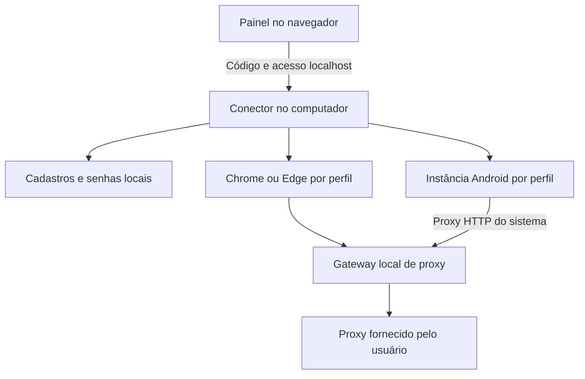

# Hot Profiles — estrutura local e central de proxies

> Atualização de 24/10/2026: o ciclo HTTP local foi validado em uma instância BlueStacks real. Veja [evidências e requisitos restantes](hot-profiles-windows-validation.md). A descoberta agora distingue portas candidatas de endpoints ADB conectados e o painel informa que isolamento integral de rede ainda não foi comprovado. Os números de testes abaixo descrevem a etapa anterior.

## Decisão

O modo padrão é **Meu computador**. O site organiza os perfis; o conector local executa os ambientes. Isso dispensa um servidor de execução contratado. O modo **Nuvem** continua acessível pelo seletor e preserva sua configuração e cadastros separados. Não houve migração automática nem deploy do site.

O caminho inicial mais leve é navegador Chrome/Edge com dados próprios por perfil. Um Android completo exige um emulador instalado e uma instância independente por perfil; o formulário não baixa nem cria a máquina virtual. O suporte existente a BlueStacks/ADB foi preservado. Virtualização, RAM, CPU e a carga de cada aplicativo limitam o número de Androids viáveis.

## Proxies

- Central com cadastro, edição, teste de conexão, busca e filtro de disponíveis/vinculados. Cada cartão mostra os perfis associados.
- Cadastro de proxy dentro do formulário de perfil, preservando os campos já preenchidos e selecionando a conexão criada.
- Um proxy por novo perfil, validado no backend e no seletor. Para transferir, encerre o ambiente anterior e remova o vínculo. Duplicar configuração de navegador não duplica o proxy.
- Cadastros antigos compartilhados são preservados; iniciar simultaneamente a mesma conexão é bloqueado. Endereço/protocolo/usuário repetidos não podem ser cadastrados de novo.
- A senha é criptografada no disco e não é devolvida ao painel. Na edição, deixar o campo vazio mantém a senha; remover é uma escolha explícita.
- Verificar conexão abre um túnel de teste. Não consulta reputação, localização ou garante IP diferente. Gateways do mesmo fornecedor com usuários distintos podem continuar usando o mesmo IP de saída.
- Sem proxy, usa a conexão normal do computador. No Android, aplicativos que ignoram o proxy HTTP do sistema não são roteados por ele; não é uma VPN do dispositivo inteiro.

## Desempenho

O painel mostra RAM total/livre, processadores lógicos, limite e sessões abertas. O padrão é uma estimativa conservadora de 1 a 4 sessões. `--max-sessions 1` até `--max-sessions 8` permite ajustar após medir o uso no computador. Não há promessa de suportar determinado número de Androids.

Só a sessão selecionada solicita prévia; abas ocultas não pedem capturas. O usuário escolhe atualização econômica, equilibrada ou mais rápida. O cache mantém um frame por sessão por até 250 ms, compartilha requisições simultâneas e é invalidado depois das ações. A invalidação aguarda capturas anteriores antes de gerar a próxima, evitando trabalho duplicado.

O teste de encaminhamento HTTP identificou uma falha existente: a conexão ao proxy continuava pausada após a autenticação CONNECT. O gateway agora retoma a leitura quando o cliente HTTP assume o socket. Um teste verifica o caminho inteiro até um destino local simulado, inclusive a remoção do cabeçalho de credenciais de proxy.

O Android usa capturas ADB sem áudio. Encerrar a sessão de controle restaura o proxy anterior, mas não desliga o emulador. Fechar instâncias pelo gerenciador libera seus recursos.

## Uso no Windows

1. Instalar Node.js 22 ou superior e Chrome ou Edge, caso ainda não estejam disponíveis.
2. Extrair todo o ZIP do conector, substituir os arquivos da versão antiga com o conector fechado e abrir `Iniciar Hot Profiles.cmd`. A pasta de dados padrão não muda: `%LOCALAPPDATA%/00duHot/HotProfiles`.
3. Publicar manualmente o site atualizado, abrir Hot Profiles → Meu computador → Conectar computador e informar o código mostrado na janela.
4. Adicionar os proxies na central e escolher uma conexão disponível em cada novo perfil.
5. Para Android, instalar/configurar o emulador, criar sua instância e ativar ADB. Selecionar a instância no perfil. Testar primeiro um ambiente com a conexão do titular antes de abrir vários.

O conector só escuta 127.0.0.1. Não expor a porta na internet. A origem já aceita é `https://feramentasdo00duhot.lovable.app`; domínio diferente exige `--allow-origin` com a origem exata. O navegador pode solicitar acesso à rede local. A conexão do painel usa token temporário mantido na sessão da aba.

## Validação e limites

66 testes do projeto aprovados localmente, incluindo 15 testes de Hot Profiles: persistência/criptografia, exclusividade de proxy/dispositivo, parser, pareamento, origem/token, cache e encaminhamento por proxies HTTP/SOCKS5 simulados. TypeScript e build de produção passaram. O ZIP foi reaberto, validado e comparado byte a byte com os nove arquivos distribuíveis do conector.

A interface foi verificada no navegador: modo local padrão, central de proxies, nuvem preservada e formulário isolado com proxy ocupado desabilitado e criação inline sem perda do rascunho. A captura `hot-profiles-local.jpg` usa o painel desconectado. O fixture temporário de teste foi removido do código.

A suíte de integração usa dados e servidores locais de teste, sem contas, cookies ou proxies reais do usuário. A execução final em Android/BlueStacks e os limites reais de simultaneidade dependem da configuração do computador do titular e ainda precisam ser conferidos nele. O novo workflow público testa Node.js no Windows e Linux antes de publicar o conector e seu SHA-256. Não contrata infraestrutura nem faz deploy do site.

Referências oficiais para a etapa de hardware: https://developer.android.com/studio/run/emulator-acceleration e https://support.bluestacks.com/hc/pt-br/articles/360056129211-Requisitos-de-sistema-para-o-BlueStacks-5 .
