# Mouse Hot — extensão de downloads para Chrome

**Estado:** versão local 3.0.0 com downloads pelo painel flutuante. O código e as instruções estão em [apps/mouse-hot-downloader](../apps/mouse-hot-downloader/README.md).

A versão 3.0 substitui o atalho do Telegram por Instagram e mantém o TikTok. A sobreposição usa a logo e inclui **Baixar**, **Selecionar tudo**, **Baixar seleção**, **Baixar tudo** e **Baixar dados do perfil**. Quando o Instagram mostra apenas uma miniatura, a extensão resolve a própria publicação em segundo plano, mantendo a aba no perfil. **Baixar tudo** inclui o que a rolagem encontra e salva `perfil.json`. O painel informa mídia indisponível e quando a busca chega a 350 itens ou 75 segundos de rolagem.

O teste local no Chrome conferiu os bytes do download individual, as duas mídias de um carrossel, a foto que apareceu ao rolar, o JSON do perfil, a deduplicação e o cancelamento da requisição em andamento. Uma checagem sem login em perfil público confirmou que o resolvedor encontra o MP4 do Reel sem navegar até ele. Não houve download completo de mídia de terceiros durante essa checagem pública.

Na 0.2.0, a versão inicial do painel lateral foi substituída por uma sobreposição recolhível, exibida automaticamente em perfis e publicações reconhecidos. O popup da barra de ferramentas abre TikTok e Telegram Web. A extensão verifica mídias nos servidores conhecidos de Instagram e TikTok com as permissões do manifesto.

No Chrome, a versão de produção abriu o painel no perfil público `@instagram` e identificou 12 links de Reel. O primeiro Reel usava `blob:` no player. O painel encontrou um MP4 nos metadados da publicação, com o código do Reel correspondente. Uma requisição parcial do worker ao servidor de mídia recebeu HTTP 206, tipo `video/mp4` e assinatura MP4. O teste automatizado também salvou um MP4 completo a partir da sobreposição, com uma publicação local que reproduzia essa estrutura. A coleta autenticada e os Stories e Destaques continuam pendentes de teste real.

As seções a seguir registram a proposta inicial e os resultados da 0.1.0.

## Pesquisa da referência

Em 11 de novembro de 2026, a ficha pública da [ScaleReels Downloader na Chrome Web Store](https://chromewebstore.google.com/detail/scalereels-downloader/cacdnmjaokblhaenjhnoaocpganndeda) informou a versão **1.7.4**, atualizada em **28 de setembro de 2026**. O REA abriu essa ficha em perfil temporário, aguardou o título e capturou a árvore de acessibilidade. Evidência: `ev_411add0634e3d8b3d5183880662e4bdc5686e5a4d95545b9fedcdf6abfa05478`. O REA encerrou o processo temporário ao terminar. A ficha e sua galeria foram observadas; o pacote não foi instalado ou inspecionado, e os fluxos dentro do Instagram e do TikTok não foram executados.

| Área | O que a ficha anuncia | Decisão para a Mouse Hot |
| --- | --- | --- |
| Plataforma e descoberta | Conteúdo já visível no Instagram e no TikTok, coletado ao rolar um perfil | Adaptadores separados, ativados só para a aba escolhida. A grade pode indicar publicações ainda sem um arquivo validado. |
| Ação individual | Botão sobre a mídia, incluindo visualizações em tela cheia, Stories e Destaques | Botão “Baixar” após ativar a extensão, com o mesmo estado mostrado no painel. Cada item de carrossel tem sua identidade. |
| Lote e rolagem | Painel, seleção que persiste ao rolar, opção de marcar tudo e rolagem automática | Painel lateral nativo. “Selecionar encontradas” informa o alcance. “Rolar e procurar” mostra o contador, tem limites e pode ser interrompido. Stories e Destaques aceitam lote dos itens encontrados, sem navegar por conteúdo indisponível. |
| Fila, progresso e falhas | Fila persistente, duas transferências por vez, pausa, cancelamento e nova tentativa | Fila independente da tela, retomada conforme o Chrome permitir, progresso individual e do lote, e motivo de falha visível. |
| Arquivos e duplicatas | Nomes estáveis, pastas por plataforma e perfil, sem recompressão | Guardar diretamente a mídia validada, evitar duplicatas por identidade e proteger arquivos existentes. |

A ficha não permite verificar os seletores, a origem exata das URLs, a deduplicação nem o mecanismo de recuperação da referência. A tabela separa o que foi anunciado do que será desenvolvido. Pagamentos, login do fornecedor e scripts personalizados da extensão de referência ficam fora do escopo de download da primeira versão.

## Experiência e integração

- **Mouse Hot** no manifesto, na barra do Chrome e no painel. A identidade visual usa a [marca do repositório](../public/brand/mark.png), PNG de 1254 × 1254, com ícones locais de 16, 32, 48 e 128 px. Preto, vermelho e dourado seguem a própria marca; os estados usam texto e ícone além de cor.
- Abrir uma publicação ou perfil, clicar em **Mouse Hot** na barra do Chrome e escolher **Baixar** na publicação ou **Selecionar encontradas** no painel. A lista diferencia **Pronto para baixar**, **Precisa abrir a publicação** e **Indisponível**. “Selecionar encontradas” seleciona somente itens validados no filtro atual; o contador mostra quantos ficaram de fora.
- A fila mostra **Aguardando**, **Baixando**, **Pausado**, **Salvo**, **Falhou** ou **Cancelado**. Só exibe “Salvo” quando o Chrome confirma. Se o tamanho total for desconhecido, mostra progresso indeterminado e quantidade concluída.
- Arquivos seguem para a pasta de downloads configurada no Chrome, dentro de `Mouse Hot/Instagram/<perfil>/` ou `Mouse Hot/TikTok/<perfil>/`.
- A extensão vive em `apps/mouse-hot-downloader/`, com compilação e testes próprios. O site existente continua como está. Quando houver um ZIP testado, incluir a ferramenta no catálogo compartilhado em `src/lib/tool-catalog.ts` e uma tela com instruções de instalação. Nenhum serviço novo, login ou banco é necessário para baixar. A primeira entrega será um ZIP para instalar como extensão descompactada no Chrome; publicar na loja é uma etapa separada.

## Arquitetura proposta

Chrome Manifest V3, TypeScript para os módulos, HTML/CSS para as telas e JavaScript empacotado na extensão. Sem código executado de servidores remotos.

```mermaid
flowchart LR
    A["Usuário ativa a extensão na aba"] --> B["Adaptador Instagram ou TikTok"]
    B --> C["Observa e identifica candidatos"]
    C --> D["Valida URL, formato e identidade"]
    D --> E["Painel: pronto, pendente ou indisponível"]
    E -->|"Usuário confirma download"| F["Fila persistente"]
    F -->|"Até 2 por vez"| G["Chrome Downloads"]
    G -->|"Progresso e resultado"| F
    F -->|"Estado atualizado"| E
```

| Arquivo ou grupo | Responsabilidade |
| --- | --- |
| `manifest.json`, `package.json`, `README.md` | Declaração MV3 e permissões, comandos de empacotamento/teste, instalação e limites. |
| `src/background/service-worker.js` | Ponto de entrada compilado. Recebe comandos com esquema validado, confere remetente, aba e documento, inicia observação e escuta eventos do Chrome. |
| `src/background/download-manager.js` | Interface com `chrome.downloads`: inicia, observa, pausa, cancela e retoma com confirmação do navegador. |
| `src/background/queue-manager.js`, `storage-manager.js` | Estados, duas vagas, retentativas e reconciliação. Versão do estado salvo, migração de formato, retenção e escrita serializada. |
| `src/content/content.js`, `media-observer.js`, `auto-scroll.js` | Injeção idempotente no mundo isolado, botão na publicação, observação incremental e rolagem limitada e interrompível. |
| `src/adapters/instagram/instagram-adapter.js`, `media-extractor.js`, `profile-scanner.js` | Reconhecer Instagram, posts, Reels, carrosséis, Stories e Destaques; resolver mídia já exibida e reconhecer itens de grade por perfil e publicação. |
| `src/adapters/tiktok/tiktok-adapter.js`, `media-extractor.js`, `profile-scanner.js` | Reconhecer TikTok, vídeos, publicações de fotos e grades; identificar miniaturas separadamente do arquivo. |
| `src/core/media-detector.js`, `media-normalizer.js` | Combinar sinais dos adaptadores e produzir um contrato comum de candidato com o contexto e o tipo de mídia. |
| `src/core/media-validator.js` | Verificar origem, redirecionamentos, acesso e formato com limites de rede. Explicar por que um item não está pronto. |
| `src/core/deduplication.js`, `file-naming.js` | Identidade por publicação e posição; nomes seguros e estáveis, extensão coerente com o arquivo e proteção contra sobrescrita. |
| `src/popup/`, `src/panel/`, `src/options/`, `src/styles/` | Atalho para ativar a aba, painel de seleção e fila, preferências locais e componentes visuais. |
| `assets/icons/`, `tests/{instagram,tiktok,core,e2e}/` | Ícones derivados da marca e testes dos adaptadores, da lógica compartilhada e do fluxo no Chrome. |

Os nomes `.js` correspondem aos módulos distribuídos no ZIP. Os arquivos de lógica poderão ser escritos em `.ts` e empacotados com esses pontos de entrada, mantendo a estrutura solicitada.

### Detecção e validação

1. O adaptador identifica a plataforma pelo domínio da aba, nunca por texto da página. Identifica também a publicação e o perfil associados. Itens de grade sem origem direta ficam pendentes.
2. O observador acompanha mudanças do DOM e da rota. Usa `video`, `img`, `source`, `currentSrc`, `src`, `srcset`, `poster`, eventos de carregamento e metadados públicos. Usa `MutationObserver` para conteúdo novo e visibilidade para priorizar o que aparece. `poster` de vídeo é prévia, não o vídeo. Em grades que reutilizam elementos, a seleção se vincula aos IDs, não aos nós da página.
3. O [Resource Timing](https://www.w3.org/TR/resource-timing/) pode sugerir recursos já observados. O sinal pode faltar, ter detalhes omitidos ou se referir a outra publicação. Nunca é usado sozinho como prova de origem, associação ou possibilidade de download.
4. O validador aceita apenas HTTPS em produção, com origem da plataforma ou CDN conhecida e autorizada, sem credenciais embutidas, IP local ou portas arbitrárias. HTTP fica restrito ao build de testes locais. Confere redirecionamentos sob os mesmos critérios; se não puder verificar o destino, recusa. Usa `HEAD` quando informativo ou uma leitura parcial, com limite de bytes e tempo. Confere o tipo e, quando preciso, a assinatura do formato antes de formar o nome do arquivo. Uma página HTML, miniatura usada como vídeo ou resposta sem tipo verificável não entra na fila.
5. A URL validada pode expirar antes da transferência. Revalida quando necessário e solicita que a pessoa reabra a publicação para detectar de novo quando ela deixa de servir. “Sem recompressão” significa guardar a versão entregue pela plataforma, que pode ser diferente do arquivo enviado pelo criador.

| Recurso encontrado | Resultado |
| --- | --- |
| URL direta de arquivo íntegro | Habilita o download após validação. |
| URL assinada ou de curta duração | Habilita enquanto válida; se expirar, pede nova detecção. |
| `blob:` / MediaSource | Informa que o player não ofereceu um arquivo direto compatível. |
| HLS, DASH ou outros fragmentos | Informa que o vídeo é segmentado. A extensão não tenta reconstruir o arquivo. |
| Sem acesso, restrição, autenticação adicional ou DRM | Informa a limitação e não tenta acessar a mídia por outros meios. |

### Permissões, persistência e recuperação

- `activeTab` + `scripting` liberam a captura após o clique. Ao sair da plataforma ou mudar de perfil, interrompe-se a rolagem e o painel vincula a seleção à origem correta. Também usa `sidePanel`, `downloads`, `storage` e, para retentativa programada, `alarms`. A validação de CDN, se exigir [acesso de origem](https://developer.chrome.com/docs/extensions/develop/concepts/network-requests), pede permissão opcional e explícita para hosts de mídia conhecidos. Se a pessoa negar e não houver outra verificação legítima, o item fica indisponível. Sem acesso amplo a sites, API de cookies, injeção de scripts do usuário ou leitura de sessões.
- Candidato: ID, plataforma, perfil, ID da publicação, posição da mídia, tipo, URL de origem, miniatura, formato, estado/motivo da validação, data de descoberta e chave de deduplicação. Preferir plataforma + publicação + posição + tipo. Se isso faltar, usar contexto da publicação e normalização conservadora de parâmetros reconhecidamente voláteis; item ambíguo não é marcado como duplicado confirmado. Usar os recursos do Chrome para renomear em caso de colisão e tratar nomes reservados e caracteres perigosos no Windows.
- `chrome.storage.session` mantém seleção, candidatos e progresso da captura por aba, origem e perfil durante a sessão; mudanças de rota que preservam o perfil conservam a seleção. `chrome.storage.local` mantém somente preferências, fila, tentativas, IDs do Chrome e histórico limitado. Uma URL assinada pendente só é retida pelo tempo necessário para a fila e não vai a logs nem a exportações. Esses dados ficam disponíveis somente nos contextos confiáveis da extensão.
- O worker MV3 pode ser suspenso. Antes de chamar o Chrome, a fila grava uma intenção de início. Ao voltar, reconcilia as intenções e os IDs com downloads iniciados pela própria extensão, sem iniciar outro quando a associação for ambígua. Retomadas respeitam `canResume`; novas tentativas automáticas são limitadas a falhas transitórias. Uma falha de URL vencida exige redetecção. O limite de dois considera as transferências reconciliadas e os novos inícios.
- Rolagem automática ocorre apenas após comando explícito, na aba escolhida, com pausa, cancelamento e limites de tempo/itens. Para ao navegar ou ao deixar de descobrir itens por várias passagens. Não promete percorrer todo o histórico de um perfil.

## Testes e limites para a entrega

| Nível | Verificação |
| --- | --- |
| Unitário | Reconhecimento de rotas e de CDN, URLs e redirecionamentos indevidos, identificação por publicação, extensão real, nomes Windows, seleção estável e estados da fila. |
| Integração local | Páginas controladas de post, perfil com grade dinâmica, carrossel, Story e TikTok; arquivo direto, HTML no lugar da mídia, URL expirada, fragmentos e arquivo interrompido. |
| Chrome com extensão descompactada | Baixar um item e um lote, manter seleção ao rolar, nunca exceder dois ativos, pausar, cancelar, reabrir o Chrome e reconciliar sem duplicar. Verificar nome, pasta, bytes e estado final do arquivo. |
| Validação real | Testar Instagram e TikTok com mídias próprias ou autorizadas. Registrar o que funcionou por plataforma, formato e superfície, incluindo casos sem arquivo direto. |

Seletores, CDNs, assinaturas, geolocalização e formatos dos dois sites podem mudar. As regras ficam nos adaptadores e validadores para atualizar um site sem afetar o outro.

### Resultado da versão 0.1.0

| Funcionalidade | Resultado | Observação |
| --- | --- | --- |
| Instalação | Validada no Chrome 157 | O navegador carregou o manifesto e abriu o painel do pacote de distribuição. |
| Instagram e download em lote | Validado localmente | Três fotos de uma página de teste foram salvas na pasta correta. O limite de dois downloads simultâneos foi confirmado. |
| TikTok e download individual | Validado localmente | O navegador salvou um MP4 de uma página de teste e a comparação confirmou os bytes originais. |
| Rolagem automática | Validada localmente | Uma publicação adicionada depois da primeira rolagem apareceu no painel. |
| Fila persistente | Validada localmente | O histórico reapareceu após fechar o painel e após reiniciar o Chrome. |
| Duplicatas, URL expirada e mídia indisponível | Validados localmente | A fila rejeitou um item repetido, registrou a resposta 403 e identificou uma URL `blob:` sem arquivo direto. |
| Pausa, retomada, cancelamento e nova tentativa | Disponíveis | Ainda faltam os cenários completos de interrupção e retomada. |
| Perfis reais do Instagram e TikTok, Stories e Destaques | Pendente | Usar mídias autorizadas para validar o comportamento dos sites e das CDNs atuais. |

Referências técnicas: [Active Tab](https://developer.chrome.com/docs/extensions/develop/concepts/activeTab), [painel lateral](https://developer.chrome.com/docs/extensions/reference/api/sidePanel), [Downloads API](https://developer.chrome.com/docs/extensions/reference/api/downloads), [Storage API](https://developer.chrome.com/docs/extensions/reference/api/storage) e [ciclo de vida do service worker](https://developer.chrome.com/docs/extensions/develop/concepts/service-workers/lifecycle).
