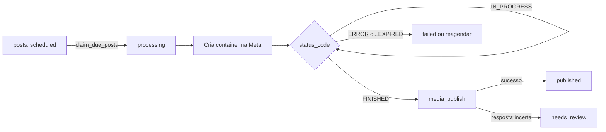

# PostKit — análise funcional e plano de implementação (automação Instagram)

## Objetivo e fonte

Este documento mapeia as funcionalidades que a [página pública do ScaleReels](https://scalereels.com.br/?ref=HOT) declara (lida em 15/10/2026) contra o que este repositório já tem, e define o que falta para recriar um sistema de paridade funcional usando a API oficial da Meta e o Supabase.

- **Fonte única:** a página pública. Não houve engenharia reversa nem análise do backend de terceiros. Tudo que a página não permite saber está marcado como DESCONHECIDO.
- **Paridade funcional, não cópia:** não se copia código, texto, marca, layout nem implementação proprietária. As regras de produto que a página não define (item DESCONHECIDO) são decisões nossas.
- **Complementa** `docs/postkit-instagram-foundation.md` (fundação de dados e segurança) e `docs/postkit-tiktok-foundation.md`.

## Inventário do repositório hoje

| Área | O que existe | Observação |
| --- | --- | --- |
| Stack | TanStack Start, React 19, Tailwind 4, TanStack Query, Zod, Recharts | Build com alvo Cloudflare (nitro); `src/lib/config.server.ts` avisa que variáveis de ambiente só valem dentro de funções |
| Rota | `src/routes/automacao-instagram.tsx` | Abas: visão geral, contas, biblioteca, agendamento, legendas e hashtags, configurações. Tudo em estado React; nada persiste |
| Banco | `supabase/migrations/20261013010000_postkit_instagram_foundation.sql` | Workspaces com papéis, contas, tokens isolados, mídia, legendas, hashtags, programações, posts, tentativas, logs, métricas, notificações, tudo com RLS |
| Storage | `supabase/migrations/20261013011000_postkit_private_media_storage.sql` | Bucket privado `postkit-media` (limite de 500 MB por arquivo), caminho começa pelo UUID do workspace |
| Supabase no código | Não existe | Sem `@supabase/supabase-js`, sem autenticação, sem Edge Functions, sem projeto vinculado |
| Servidor | Não existe | Sem OAuth, sem publicação, sem agendador, sem métricas |
| Testes | Não existe | `package.json` não tem script de teste |
| `.env` | Versionado, com duas variáveis públicas do Cloudinary | Sem segredos; manter assim e nunca pôr credencial privada em `VITE_*` |

## Funcionalidades declaradas e lacunas

A coluna "No repositório" descreve o que existe como schema ou interface. Nenhum item está operacional, porque nada publica de verdade ainda.

| ID | Funcionalidade declarada | No repositório | Lacuna para operar |
| --- | --- | --- | --- |
| F1 | Agendador de Reels, carrosséis e Stories, com fila, horários automáticos e login oficial | `posts.content_type` (reel, image, carousel, story), `publishing_schedules` (limite diário, intervalo, horários), prévia local | OAuth, publicação no servidor, preenchimento automático da fila, itens de carrossel |
| F2 | Integração com TikTok | Fundação própria em `docs/postkit-tiktok-foundation.md` | Fora desta análise (API do TikTok) |
| F3 | Limite de contas e posts compartilhado entre redes | Nenhum | Quotas por plano (ver F14) |
| F4 | Acervo compartilhado: um vídeo serve várias contas e ocupa espaço uma vez | `media_assets` é por workspace e `posts` referencia o arquivo, então já permite reuso | Interface de vínculo e contagem de armazenamento por workspace |
| F5 | Rodízio de legendas e hashtags, por conta e por nicho | `caption_sets` e `hashtag_groups` com `rotation_enabled` | Nenhum estado de rodízio (qual legenda foi usada por último) e nenhum vínculo entre programação e conjuntos |
| F6 | Repost automático quando a fila zera | Nenhum | Marcação de repost no acervo e regra de reenfileiramento |
| F7 | Painel de análise: totais, curva de 30 dias, ranking de contas | `post_metrics_snapshots` | Sincronização de insights e consultas agregadas |
| F8 | Editor de vídeo em massa (moldura, marca d'água, proporção) | Nenhum | Fora desta fase; avaliar FFmpeg.wasm depois |
| F9 | Extensão que baixa vídeos de TikTok e Instagram sem marca d'água | Nenhum | **Não será implementada** (ver riscos) |
| F10 | Repost em grupos de Telegram com bots | Nenhum | Fora desta análise (API de bots do Telegram) |
| F11 | Notificações push a cada publicação | Tabela `notifications` (avisos dentro do app) | Assinaturas Web Push e envio |
| F12 | Envio pelo painel, com detecção de arquivos novos e agendamento avulso | Seleção local de arquivos MP4, MOV e WEBM, bucket privado | Upload real, validação e registro em `media_assets` |
| F13 | Publicação 24/7 sem computador ligado | Nenhum | Execução agendada no servidor |
| F14 | Planos com limites de contas, posts por mês e armazenamento | Nenhum | Tabelas de limites e checagem no servidor (depende da decisão de cobrança) |

## Desconhecidos (a página não permite saber)

- Se Stories e carrosséis contam no limite mensal de posts, e se o teto de 10 por dia do plano de teste vale nos pagos.
- O que acontece ao atingir o limite de armazenamento.
- A frequência de reposts e a regra de reaproveitamento do acervo.
- Preço e plano do editor, e se a extensão no plano inicial é inclusa ou paga à parte (tabela e FAQ divergem).
- A diferença prática entre "sem teto" e "30 contas" no plano Agência.
- O que o teste inclui além dos limites, o destino do conteúdo após os 3 dias e se inclui o Repost Telegram.
- Renovação automática via Pix, reembolso e cancelamento.
- Formatos e limites da integração com TikTok, e quais métricas existem por rede.
- O texto de Termos, Privacidade e Exclusão de dados.
- Toda a implementação interna: hospedagem dos vídeos, fila, cálculo de horários, rodízio, tratamento de falhas e do limite diário da API.

## Decisões em aberto

1. **Onde roda o servidor.** Duas opções:
   - **Supabase Edge Functions com pg_cron:** o agendador independe do host do app e dos limites da Cloudflare; exige o projeto Supabase de desenvolvimento e a CLI.
   - **Server functions do TanStack Start:** menos peças, mas o app roda como Worker e o agendamento precisaria de cron separado.
   - Recomendação: Edge Functions com pg_cron para OAuth, publicação e sincronização, mantendo o app só como interface.
2. **Cobrança e planos (F14).** A página usa Pix mensal. Decidir se haverá cobrança neste produto antes de criar tabelas de plano; mexe em pagamento e deve ser tratado como mudança de risco.
3. **Acesso externo.** Para conectar contas de outras pessoas, o app Meta provavelmente precisa passar pelo App Review (confirmar os requisitos vigentes antes de abrir a clientes).

## Arquitetura de publicação

Todo o fluxo roda no servidor. O navegador só cria e edita registros protegidos por RLS.

### API oficial da Meta (Instagram API with Instagram Login)

Conferido na documentação oficial em 15/10/2026:

- Host `graph.instagram.com`; escopos `instagram_business_basic`, `instagram_business_content_publish` e `instagram_business_manage_insights`; só contas profissionais.
- Reel: `POST /{ig-user-id}/media` com `media_type=REELS` e `video_url`; consultar `GET /{container-id}?fields=status_code` cerca de uma vez por minuto, por até 5 minutos; publicar com `POST /{ig-user-id}/media_publish` usando `creation_id`. O container expira em 24 horas se não for publicado.
- Carrossel: um container filho por item (até 10, `is_carousel_item=true`), depois o container `CAROUSEL` com `children`. Stories: `media_type=STORIES`.
- Limite: 100 publicações por conta em janela móvel de 24 horas (carrossel conta como uma). A documentação cita 50 numa seção de carrossel; usar `GET /{ig-user-id}/content_publishing_limit` como fonte da verdade antes de cada publicação.
- O vídeo precisa estar numa URL pública no momento da tentativa; o fluxo de Instagram Login não aceita upload retomável.
- Insights (`instagram_business_manage_insights`): usar `views`, `reach`, `likes`, `comments`, `shares`, `saved` e `total_interactions`. `impressions` e `plays` foram descontinuados. Dados podem atrasar até 48 horas, indisponível volta vazio (não zero), Stories só têm insights por 24 horas e falham com menos de 5 visualizações. Não há webhook de insights nesse login: sincronizar por consulta periódica.

A conferir antes de implementar (não verificado nesta análise): URLs de autorização e troca de código, troca por token de longa duração e endpoint de renovação, formatos, tamanho, duração e proporção aceitos para vídeo, e se o limite de 500 MB do bucket é compatível.

### Regras de segurança e confiabilidade a manter

- Token só em `instagram_tokens` (sem política de cliente), cifrado com chave guardada em segredo do servidor, e nunca em log.
- A URL do vídeo para a Meta é assinada, de curta duração, gerada no servidor a partir do bucket privado.
- Seleção de posts vencidos por função SQL com `FOR UPDATE SKIP LOCKED`, executável só pelo papel de serviço.
- Idempotência: cada tentativa grava `publish_attempts` antes de chamar a Meta; `posts.idempotency_key` já existe.
- Resposta incerta no `media_publish` vira `ambiguous` na tentativa e `needs_review` no post; nunca repetir às cegas. Reconciliar consultando o `status_code` do container (valor `PUBLISHED`).
- Horários em UTC no banco, fuso por programação.

## Alterações de banco propostas

Sempre em migrations novas em `supabase/migrations/AAAAMMDDHHMMSS_descricao.sql`; nunca editar as existentes.

| Mudança | Detalhe | Atende |
| --- | --- | --- |
| Proteger colunas controladas pelo servidor | Hoje a política "editors can manage posts" deixa um editor alterar `status`, `meta_media_id`, `attempt_count` e `permalink` pelo cliente; o mesmo vale para `connection_status`, `scopes` e `token_expires_at` em `instagram_accounts`. Criar triggers que bloqueiem essas colunas para o papel `authenticated` | Segurança de F1 |
| `post_items` | `post_id`, `workspace_id`, `media_asset_id`, `position`, chaves compostas como nas demais tabelas, RLS igual a `posts` | F1 (carrossel) |
| Vínculo de programação com conteúdo | Em `publishing_schedules`: `caption_set_id`, `hashtag_group_id` e cursor de rodízio (índice da última legenda e do último grupo usados) | F5 |
| Repost | `media_assets.repost_enabled` e, em `publishing_schedules`, `repost_enabled` e intervalo mínimo de repost em dias (padrão a definir) | F6 |
| `claim_due_posts(limit)` | Função `security definer` com `FOR UPDATE SKIP LOCKED`, execução revogada de `authenticated` | F13 |
| Consulta de análise | View com `security_invoker` somando o último snapshot por post e por dia, agrupada por conta | F7 |
| `push_subscriptions` | `workspace_id`, `user_id`, endpoint e chaves Web Push, RLS por usuário | F11 |
| Planos (só se houver cobrança) | Limites de contas, posts por mês e bytes, e plano por workspace | F3, F14 |

## Servidor (Edge Functions e agendador)

| Função | Gatilho | O que faz |
| --- | --- | --- |
| `instagram-oauth-callback` | Redirecionamento do login | Valida o `state`, troca o código, cifra e grava o token, preenche `instagram_accounts` |
| `instagram-token-refresh` | pg_cron diário | Renova tokens antes de `token_expires_at` e marca `expired` quando falha |
| `queue-fill` | pg_cron por hora | Por programação ativa, gera horários do dia no fuso, respeita `daily_limit` e `minimum_interval_minutes`, escolhe mídia ainda não postada na conta, aplica o rodízio e cria `posts` como `scheduled`; com a fila zerada e repost ligado, reenfileira a mídia postada há mais tempo |
| `publish-dispatch` | pg_cron por minuto | Chama `claim_due_posts`, confere o limite da API, cria o container e grava a tentativa |
| `publish-finalize` | pg_cron por minuto | Consulta o container, publica, grava `meta_media_id` e `permalink`, agenda retry limitado ou marca `needs_review`; insere em `notifications` |
| `insights-sync` | pg_cron a cada 6 horas | Grava `post_metrics_snapshots` para posts publicados, tratando vazio como ausente |
| `push-notify` | Após publicar | Envia Web Push aos usuários do workspace |

## Interface

A rota `src/routes/automacao-instagram.tsx` já tem as abas. O trabalho é trocar o estado local por dados reais, sem redesenhar:

- **Contas:** conectar, reconectar e ver status e expiração; hoje é marcador de fluxo pendente.
- **Biblioteca:** upload real no bucket privado, vínculo de um arquivo a várias contas, repost por item, uso de armazenamento.
- **Agendamento:** fila persistida, edição de horário, cancelar e pausar; carrossel e Stories como tipos separados.
- **Legendas e hashtags:** conjuntos persistidos com rodízio e vínculo à programação.
- **Configurações:** fuso, limite diário, intervalo, horários, repost, notificações push.
- **Análise (nova aba):** totais, curva de 30 dias e ranking de contas com Recharts, que já está instalado.
- **Histórico:** tentativas, logs e notificações lidos das tabelas existentes.
- **Rótulos honestos:** nenhum indicador de publicação real aparece sem dado confirmado pela API.

## Plano de commits (um commit cada)

Cada commit leva a migration junto do código que depende dela e termina com lint, build e testes passando. A tarefa 0 não gera commit.

0. **Sem commit:** criar o projeto Supabase de desenvolvimento, decidir onde roda o servidor e se haverá cobrança.
1. `chore: adiciona cliente supabase e executor de testes`: dependência, cliente do navegador com chave pública, script de teste.
2. `feat: adiciona autenticacao e selecao de workspace`: login, criação e escolha de workspace.
3. `fix: protege colunas controladas pelo servidor`: migration com os triggers de `posts` e `instagram_accounts`, com teste de RLS de dois usuários.
4. `feat: persiste biblioteca no storage privado`: upload, validação real e registro em `media_assets`.
5. `feat: persiste legendas, hashtags e programacoes`: migration do vínculo e do cursor de rodízio, mais as abas.
6. `feat: adiciona oauth do instagram no servidor`: função de callback, cifra de token, segredos do servidor.
7. `feat: renova tokens do instagram antes de expirar`: função e pg_cron. Depende de 6.
8. `feat: publica reels com fila e idempotencia`: migration `claim_due_posts`, `publish-dispatch` e `publish-finalize`, com teste de concorrência e de resposta incerta. Depende de 3, 4 e 6.
9. `feat: adiciona historico e notificacoes no app`: tentativas, logs e avisos lidos das tabelas. Depende de 8.
10. `feat: preenche a fila automaticamente por horarios e rodizio`: `queue-fill`. Depende de 5 e 8.
11. `feat: adiciona repost automatico`: migration das colunas e regra no `queue-fill`. Depende de 10.
12. `feat: adiciona carrossel e stories`: migration `post_items` e ajuste das funções. Depende de 8.
13. `feat: sincroniza insights e cria painel de analise`: migration da view, `insights-sync` e aba. Depende de 8.
14. `feat: adiciona notificacao push a cada publicacao`: migration `push_subscriptions`, função e service worker. Depende de 9.
15. `feat: adiciona quotas por plano`: só após a decisão de cobrança; checagem no servidor, não só na tela.

## Riscos e fora do escopo

- **F9, extensão de download sem marca d'água:** não será implementada. A API oficial não cobre isso, e baixar conteúdo de terceiros removendo a marca conflita com os termos das plataformas e com direitos autorais. Publicar apenas mídia própria ou licenciada.
- **Conteúdo repetido:** repostar o mesmo vídeo em várias contas e em ciclo pode reduzir alcance; o intervalo mínimo de repost deve ser configurável.
- **Limites da API:** 100 publicações por 24 horas por conta, sem tags de produto, de marca nem filtros, carrossel só com JPEG nas imagens e até 10 itens, insights com atraso e sem webhook.
- **TikTok e Telegram:** exigem APIs próprias e ficam em fases futuras, em especificações separadas.
- **Produção:** não aplicar migrations em produção sem revisão e testes de RLS com pelo menos dois usuários em workspaces separados.

## Fontes

- [ScaleReels, página pública](https://scalereels.com.br/?ref=HOT)
- [Instagram Platform: publicação de conteúdo](https://developers.facebook.com/docs/instagram-platform/content-publishing/)
- [Instagram Media Insights](https://developers.facebook.com/docs/instagram-platform/reference/instagram-media/insights/)
