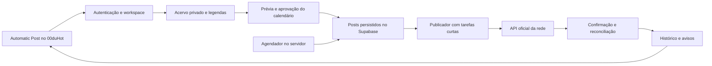

# ScaleReels: pesquisa e proposta de integração ao 00duHot

Data: 03/11/2026. Escopo confirmado pelo usuário: integrar ao 00duHot.
Estado desta entrega: pesquisa, análise de referência e planejamento; não é uma nova implementação nem uma publicação em produção.

## 1. Conclusão

Evoluir o módulo existente **Automatic Post**, começando por publicação de Reels no Instagram com fila persistente. Aproveitar React/TanStack, Supabase, componentes e autenticação do projeto, mantendo preview e publicação pela Lovable.

O produto depende principalmente de integração com plataformas, armazenamento e execução confiável de tarefas. Emulador Android, proxy por perfil e engenharia reversa de executáveis não são requisitos para o fluxo oficial de publicação. Hot Profiles permanece um módulo separado.

Implementar código e identidade visual próprios. A análise do ScaleReels serve como referência funcional; os arquivos de terceiros baixados para pesquisa não devem entrar no aplicativo, no build ou no repositório público.

## 2. Evidências e limites da pesquisa

- REA MCP 6.7.0 efetivamente utilizado no alvo.
- `capture_browser_scenario`: Chrome temporário, sem cookies anteriores, abertura de `https://scalereels.com.br/painel`, espera pelo documento e estabilização. Capturas de DOM, acessibilidade, URL e metadados de rede; sem corpos de requisição/resposta nem valores de cabeçalhos. Evidência `ev_9ed77911bb8006d6ee2b080d16259e2d4490ebd7f26dc256f0c4980520a08e99`.
- A árvore de acessibilidade mostrou a tela de login. O HTML também contém estruturas de telas internas escondidas. Isso **não** significa que foi obtido acesso ao painel autenticado. Um texto de manutenção presente no HTML não apareceu como tela ativa na captura.
- O navegador temporário foi encerrado pelo REA (`terminated-owned-process`); captura completa dentro das opções solicitadas.
- Oito scripts públicos referenciados pelo próprio documento foram baixados e analisados como texto, sem executar os arquivos locais: `core`, `conexao-conta`, `horarios`, `bulk-posts`, `stories`, `story-link`, `analytics` e `tiktok`.
- Análise estática REA: 8 arquivos, 277.063 bytes, 32.017 nós de sintaxe visitados, zero falhas de parsing. Evidência completa `ev_89401819ff67c7a36a7d4d5a6fc93cb7b38b62338bb307a3782549c24b0f878b`. Digest do conjunto: `55937b3ddbb6abf058009c6117955c62599fc48e926e67f01b38b1b2351ba7a2`.
- Parsing bem-sucedido não representa entendimento completo: o REA declarou cobertura parcial e 6.518 relações semânticas desconhecidas. Backend, banco, infraestrutura, confiabilidade e execução das funções autenticadas não foram verificados.
- Nenhum cadastro, pagamento, instalação de extensão, conexão de rede social ou publicação foi realizado. Não foram consultadas credenciais/sessões do usuário nem endpoints privados encontrados no código.
- Evidências exportadas antes do encerramento da análise: `.hot-profiles/research/scalereels-20261103/rea-evidence.json` (33.442.533 bytes). Material local de pesquisa, fora do versionamento normal.

## 3. O que a referência oferece

A [página pública](https://scalereels.com.br/) anuncia múltiplas contas, agendamento de Reels, fotos/carrosséis e Stories, acervo compartilhado, rodízio de legendas/hashtags, repetição opcional do acervo, métricas e notificações. Também apresenta editor local, extensão e ferramentas Telegram. São declarações comerciais, não resultados de testes de publicação.

O [documento público do painel](https://scalereels.com.br/painel) contém estruturas para conexão de contas, horários, biblioteca, fila, histórico, Drive, assinatura e suporte. Esses elementos ajudam a mapear requisitos, mas não confirmam que estão habilitados para todos os clientes.

A leitura estática de [story-link.js](https://scalereels.com.br/story-link.js?v=20260929loja) indica dependência de extensão para Story com link. O script [tiktok.js](https://scalereels.com.br/tiktok.js?v=20260920arroba) também contém telas de importação por cookies. São caminhos distintos da publicação oficial; não foram executados e não compõem o MVP proposto.

Não assumir o stack do servidor com base em nomes de endpoints ou no JavaScript. O backend do concorrente não foi recuperado.

## 4. Base existente no 00duHot

Inspeção de código local, sem consultar segredos ou banco remoto:

| Área | Evidência no repositório | Situação constatada |
|---|---|---|
| Navegação | `src/lib/tool-catalog.ts` | Automatic Post já existe; evitar segundo cartão equivalente. |
| Instagram | `src/routes/automacao-instagram.tsx` | Upload ao bucket privado, registro de mídia, leitura/gravação de posts e horários por fuso já aparecem no código. |
| OAuth | `src/lib/instagram-oauth.server.ts`, `src/lib/api/instagram-oauth.functions.ts`, callback | Estado assinado, tokens cifrados e conexão oficial têm implementação. Configuração real não validada. |
| Publicador | `src/lib/social-publishing.server.ts` | Fluxo de criar container, consultar processamento e publicar Reel. |
| Fila | `src/routes/api.instagram.worker.ts` e migration de worker | Reserva atômica de tarefas, tentativas e tratamento de expiração. Agendador ativo não confirmado. |
| Banco | Migrations PostKit de 13 e 17/10 | Workspaces, membros, contas, tokens, mídia, posts e logs previstos. Aplicação no Supabase não comprovada nesta pesquisa. |
| TikTok | `src/routes/automacao-tiktok.tsx` | Preparação local e publicação manual; não foi localizada integração real de postagem nesse fluxo. |

Os documentos antigos de fundação descrevem uma fase anterior e subestimam o código Instagram atual. Este levantamento não certifica produção: ter código não comprova secrets, migrations, OAuth aprovado ou publicação real funcionando.

Verificação executada: `node --experimental-strip-types --test tests/instagram-oauth.test.mjs tests/social-publishing.test.mjs` — **6 testes passaram**, com dados sintéticos/mocks. Cobrem assinatura, criptografia, cookie, sequência de publicação, HTTPS e não repetição após resultado ambíguo. Não são testes reais contra Meta/TikTok. Nenhuma alteração de runtime foi feita nesta etapa.

## 5. Requisitos externos que afetam a construção

### Instagram

A [coleção oficial da Meta no Postman](https://www.postman.com/meta/instagram/documentation/6yqw8pt/instagram-api) documenta contas profissionais e publicação em etapas: criar container, aguardar processamento e publicar. Mídia por URL precisa estar acessível à Meta durante a tentativa. No fluxo Facebook Login, Stories são limitados a contas Business; verificar o suporte específico do fluxo escolhido antes de habilitar esse formato.

Para o código atual, que usa Instagram Login, confirmar `instagram_business_basic` e `instagram_business_content_publish`, versão da API, callback HTTPS e nível de acesso necessário ao público do aplicativo. [Referência de Instagram Login](https://www.postman.com/meta/instagram/folder/1z5vxzu/instagram-api-with-instagram-login).

A página direta de content publishing da Meta retornou HTTP 429 na pesquisa; a coleção oficial foi a fonte alternativa. Quotas, revisão do app e recursos avançados precisam de nova confirmação no momento da integração; não fixar limites universais por suposição.

### TikTok

O [guia de Direct Post](https://developers.tiktok.com/docs/en/content-posting-api-get-started) exige app registrado, escopo `video.publish` aprovado e autorização da conta. Clientes sem auditoria têm publicação restrita ao modo privado.

As [diretrizes de compartilhamento](https://developers.tiktok.com/docs/en/content-sharing-guidelines) também restringem clientes destinados somente ao uso interno de uma equipe e rejeitam apps focados em copiar conteúdo arbitrário de outras plataformas. Como o 00duHot pode ser uma ferramenta interna, a viabilidade de Direct Post público é uma decisão bloqueadora: não basta implementar o endpoint. Manter preparação/exportação manual até existir um uso elegível e aprovação. A interface deve respeitar consentimento, privacidade e capacidades retornadas para o criador.

### Supabase e hospedagem

[Cron](https://supabase.com/docs/guides/cron) pode disparar trabalho periódico; [Queues](https://supabase.com/docs/guides/queues) oferece mensagens persistentes. Entrega da fila não garante publicação externa exatamente uma vez: persistir IDs e reconciliar resultados incertos continua necessário.

As [Edge Functions têm limites de tempo, memória e CPU](https://supabase.com/docs/guides/functions/limits). Recomendo operações curtas e retomáveis; não um processo infinito, nem transcodificação pesada dentro delas. O worker atual é uma rota TanStack, portanto também é preciso confirmar o limite efetivo do runtime da Lovable antes de escolher onde executá-lo.

Para publicar com PC desligado, agendador e publicador precisam de execução no servidor. Custos variam com armazenamento, tráfego, processamento e plano existente; não foi feita contratação ou estimativa monetária sem volume de uso.

## 6. Arquitetura proposta — implementação própria

Preservar as tabelas PostKit existentes; evoluir por migrations pequenas. Acrescentar vínculos de mídia por conta, identificadores externos de processamento, estados retomáveis, aprovação da programação, política explícita de repetição e bloqueio de concorrência por conta. Guardar UTC e fuso IANA; a prévia precisa corresponder aos instantes persistidos.

Um arquivo pode alimentar várias contas do mesmo workspace sem novo upload. Deduplicação deve ser restrita ao workspace, com referências para não apagar uma mídia ainda utilizada. Separar retenção dos arquivos de retenção dos registros de publicação.

Tokens e secrets ficam exclusivamente no servidor. Usuário deve conectar por OAuth e poder revogar. Logs e mensagens ao usuário não devem expor credenciais. RLS precisa ser testado com duas organizações e usuários de papéis diferentes.

Estados sugeridos: rascunho, agendado, preparando mídia, aguardando processamento, publicando, publicado, falhou, cancelado e requer conferência. Se houver timeout após envio, não publicar novamente sem verificar o resultado anterior.

A limpeza de metadados existente continua local, como determina `AGENTS.md`. O upload para publicação é uma ação separada e explícita; não aproveitar silenciosamente arquivos selecionados na ferramenta de limpeza.

## 7. Entregas e critérios de aceite

1. **Consolidar a base existente:** atualizar documentação e identificar ambiente Supabase/Lovable. Conferir migrations/RLS, callback e secrets pelo estado de configuração, sem imprimir valores. Reels como primeiro formato.
2. **Acervo e calendário:** upload validado, progresso/cancelamento, seleção de contas, legenda editável, horários, prévia e confirmação do lote. Recarregar a página deve preservar tudo que foi salvo.
3. **Publicação resiliente:** persistir container/ID externo antes de avançar, processar em passos, respeitar limites, retomar processamento e reconciliar resultados ambíguos. Confirmar gravações no banco antes de exibir sucesso.
4. **Histórico e operação:** estado individual por conta/post, pausa, cancelamento, reconexão e avisos acionáveis. Contadores somente de dados confirmados; dado ausente não é zero.
5. **Expansão:** carrossel, Stories e métricas após validação de capacidade/permissão. TikTok automático condicionado à elegibilidade e aprovação. Drive, editor e push são fases posteriores, não dependências do primeiro Reel.

Antes de liberar: dois usuários isolados; mesma mídia em duas contas; colisão de dois workers; expiração de autorização; 429; vídeo inválido; URL expirada; callback repetido; reinício durante processamento; resposta perdida após publicação; erro do banco após sucesso externo; cancelamento concorrente e troca de fuso. Fazer uma publicação real autorizada em conta de teste e confirmar o ID/link na plataforma. Simulações aprovadas não substituem essa etapa.

Pontos de revisão já visíveis no código: o worker aguarda vários posts sequencialmente e pode exceder o tempo do host; retorno de atualização do banco precisa ser verificado; o ID do container deve ser persistido para retomada; resposta de publicação sem ID deve ser tratada como incerta; validação do arquivo não pode depender apenas do MIME informado pelo navegador. São itens para a implementação, não correções aplicadas nesta pesquisa.

## 8. Pendências objetivas

- Confirmar projeto Supabase de desenvolvimento e estado real das migrations e do bucket.
- Confirmar se já existe app Meta aprovado, contas profissionais de teste e domínio/callback configurados. Não enviar senhas no chat.
- Determinar público do 00duHot para avaliar a elegibilidade TikTok.
- Definir contas simultâneas, posts por dia, tamanho médio e retenção de mídia para dimensionar custo/capacidade.
- Se for necessário validar a experiência interna do concorrente, usar acesso legítimo disponibilizado pelo usuário; esta pesquisa cobriu somente conteúdo público.

Próximo passo técnico recomendado: auditoria e conclusão do fluxo Instagram já existente, do upload até a confirmação de um Reel, no preview Lovable e Supabase de teste. Não criar um segundo agendador paralelo.
